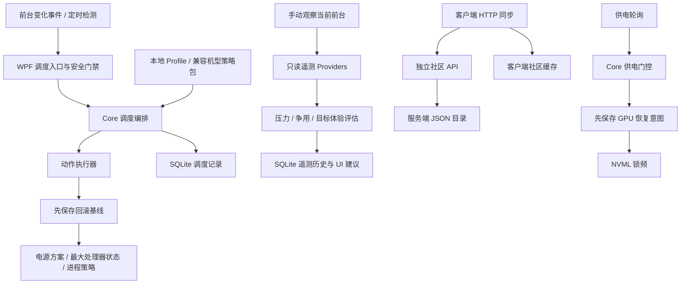

# 开发接手说明

核验日期：2026-10-08。本说明基于当前工作区的源码、测试和实际构建结果；Git 基准为 `main` 分支的 `85a5cd6`（`Complete scheduler foundation and telemetry stack`）。工作区已有客户端/服务端目录重组和大量未提交内容，本次核验对象不是单独的 HEAD 提交。

当前已具备前台自动调度、配置与恢复、只读遥测、NVML 锁频/复位封装、供电轮询门控、硬件自检和社区 HTTP 同步。目标体验自动闭环、运行时仲裁注入、完整 GPU 基线/对账及实机验收仍未完成。

**最新续接入口见第 17 节。** 本轮客户端 491 项、服务端 3 项 Release 测试通过，两端 Release 构建均为 0 警告、0 错误；验证记录见第 17 节。第 9 节保留首次接手的历史测试结果，第 11–16 节为此前阶段摘要；准确能力边界以当前源码和第 7、17 节为准。

用户要求由主代理独立完成，禁止直接或间接使用子代理；先完成后端与硬件功能，再考虑 UI 布局、菜单位置，继续保持 Core / Infrastructure / App 分层。本轮补齐供电补偿、自检协调、恢复及状态文案，未调整界面布局。

产品术语见根目录 [CONTEXT.md](../CONTEXT.md)；总体路线见 [项目规划](project-plan.md)。本文件保存实现入口、行为边界和验证基线，后续相关实现改变时应同步更新。

## 1. 项目组成与入口

| 部分 | 当前职责 | 主要入口 |
| --- | --- | --- |
| 客户端 Core（.NET 10） | 配置模型、匹配、调度编排、安全门禁、遥测评估；不直接调用 Windows | [SchedulerOrchestrator.cs](../客户端/src/PerformanceScheduler.Core/Services/SchedulerOrchestrator.cs) |
| 客户端 Infrastructure（.NET 10） | Win32、powercfg、JSON、SQLite、厂商检测和可选采集器 | [PowerCfgPowerPlanManager.cs](../客户端/src/PerformanceScheduler.Infrastructure/Power/PowerCfgPowerPlanManager.cs)、[FileRollbackManager.cs](../客户端/src/PerformanceScheduler.Infrastructure/Rollback/FileRollbackManager.cs) |
| 客户端 App（.NET 10 Windows / WPF） | 手动组装依赖、生命周期、界面、配置迁移和诊断导出 | [App.xaml.cs](../客户端/src/PerformanceScheduler.App/App.xaml.cs)、[AppRuntime.cs](../客户端/src/PerformanceScheduler.App/Services/AppRuntime.cs) |
| 客户端测试 | Core 规则、平台适配、持久化、恢复和部分 App 服务 | [PerformanceScheduler.Tests](../客户端/tests/PerformanceScheduler.Tests) |
| 社区服务端（ASP.NET Core 10） | 独立的只读 JSON 目录 API，无客户端项目引用 | [Program.cs](../服务端/src/SuiXinTiao.Community.Api/Program.cs)、[CommunityCatalogStore.cs](../服务端/src/SuiXinTiao.Community.Api/Services/CommunityCatalogStore.cs) |



图中调度写入与手动观察是不同入口。社区同步更新本地缓存，用户导入后仍默认禁用；GPU 门控使用独立恢复意图，尚未纳入普通 Profile 调度事务。

## 2. 启动、监控与退出

启动首先取得单实例互斥锁，然后构建 `AppRuntime`、初始化调度与遥测数据库、执行启动恢复，再把恢复结果交给界面安全门禁。恢复问题未解决时不能通过普通“恢复监控”操作绕过保护。

运行状态、日志根目录为 `%LOCALAPPDATA%\PerformanceScheduler`。其中 `runtime` 保存 `scheduler.db`、`rollback-state.json`、`startup-session.json`、`startup-failures.json`、`ui-settings.json` 及社区目录缓存；日志在 `logs`。

Profile 与机型策略包有两种存储位置，由 [ConfigurationStoragePathResolver.cs](../客户端/src/PerformanceScheduler.App/Services/ConfigurationStoragePathResolver.cs) 决定：程序目录可写时使用程序目录的 `profiles`、`device-strategies`；否则使用上述用户数据根目录下的 `configuration`，并在目标目录没有 JSON 配置时从程序目录播种。因此，运行时编辑的配置不一定写入仓库里的样例目录。

主要监控逻辑在 [MainWindowViewModel.cs](../客户端/src/PerformanceScheduler.App/ViewModels/MainWindowViewModel.cs)：

- 前台变化事件经过约 180ms 的去抖，并由定时检测兜底；默认周期 2 秒。
- 自动启动监控默认关闭；启动恢复保护、自动恢复及重复异常后禁用配置默认开启，重复异常阈值为 2。
- 生命周期锁负责串行处理开始、停止和释放；刷新锁防止定时检测、事件检测和手动检测重叠。
- 停止监控会停止新的检测并等待在途任务；**停止监控本身不等于回滚已应用状态**。手动恢复和应用退出有独立恢复路径。
- 手动调度检测可能执行系统修改；诊断中的“观察当前前台”入口只读。

正常退出先释放监控和供电轮询，再尝试 GPU 与普通调度恢复。恢复成功且启动状态满足条件才允许正常关闭标记，写标记前再次检查 GPU 恢复。突然终止无法保证执行退出代码，遗留恢复依赖下次启动读取状态文件。

## 3. 调度事务的实际行为

主链路由 [SchedulerOrchestrator.cs](../客户端/src/PerformanceScheduler.Core/Services/SchedulerOrchestrator.cs) 和 [SchedulerActionExecutor.cs](../客户端/src/PerformanceScheduler.Core/Services/SchedulerActionExecutor.cs) 组成，检测与恢复经 [SchedulingSessionCoordinator.cs](../客户端/src/PerformanceScheduler.Core/Services/SchedulingSessionCoordinator.cs) 串行处理。

1. 检测能力、识别前台进程、读取供电状态、加载本地配置及兼容策略包。
2. 选择启用且符合供电条件的配置，计算会话身份。
3. 会话变化时先恢复旧事务；遗留或不可读的回滚状态阻止开启新事务。
4. 收集进程身份和原始值，先保存回滚基线，再切换电源方案并读取确认；高级电源项的原始值在确认后的目标方案上读取并再次保存，然后修改高级项与进程策略。
5. 动作写入后读取确认，收集运行信息并保存调度审计；成功记录后才注册活动会话。

会话身份包含进程 PID、启动时间、进程名称/路径、Profile ID/版本/内容摘要和供电状态。同一会话重复检测跳过重复写入，但仍更新运行记录。失败退避从 5 秒增长到最多 60 秒，重置窗口为 5 分钟。

调度审计入库失败会触发回滚并暂停调度；遥测历史保存失败只影响诊断。两种持久化失败不能采用相同处理方式。动作状态还区分 `Applied`、`Skipped`、`Unsupported`、`Failed`；部分能力不支持不等于所有动作失败，也不能把局部应用呈现为完整生效。

[ProfileMatcher.cs](../客户端/src/PerformanceScheduler.Core/Services/ProfileMatcher.cs) 使用累加评分：可执行文件 100、进程名 80、窗口标题 40、匹配分类 30、目标分类 20、特定供电条件 15。同分保留先遍历到的配置，没有普通配置得分时才使用全局默认。匹配条件不是全部必须命中的 AND 关系；当前供电匹配自身也可贡献正分。修改此行为会改变已有配置选择，须按契约变更处理。

机型策略由 [DeviceStrategyRuntimeSelector.cs](../客户端/src/PerformanceScheduler.Core/Services/DeviceStrategyRuntimeSelector.cs) 选择：同硬件优先于同机型，跳过禁用或不匹配供电条件的包，选出一个包后补充本地库中缺失的 Profile ID。**本地同 ID 配置保持优先，即使本地项被禁用**。设备指纹有 5 分钟缓存，读取或解析失败退回本地配置。

## 4. 必须保持的恢复边界

[SchedulerState.cs](../客户端/src/PerformanceScheduler.Core/Models/SchedulerState.cs) 记录电源方案、高级项、进程优先级和效率模式的原始/已应用值及身份，没有 GPU 字段。GPU 另用 `runtime/gpu-clock-recovery.json` 保存复位意图；它不是原锁频基线，也不支持第三方原设置恢复。

[FileRollbackManager.cs](../客户端/src/PerformanceScheduler.Infrastructure/Rollback/FileRollbackManager.cs) 的恢复不是无条件覆盖系统：

- 同一事务追加状态时保留最早的原始值，更新最新的已应用值；不同事务不能直接合并。
- 只有当前值仍符合该事务的已应用值时才恢复原值，避免覆盖用户或其他工具后续的修改。
- 进程操作和恢复检查 PID 与启动时间等身份信息；进程退出或 PID 被复用时跳过该目标。
- 读取失败、格式错误或恢复不完整时保留状态文件及未完成项，不把未知状态视为成功。
- 旧记录缺少足够身份或已应用值时不会盲目恢复。实际恢复按电源方案、高级项和进程项处理，不能笼统称为所有动作的逆序执行。
- 写入后发生异常或取消，恢复路径使用不受原取消令牌影响的执行方式。

[FileStartupRecoveryManager.cs](../客户端/src/PerformanceScheduler.Infrastructure/Safety/FileStartupRecoveryManager.cs) 独立处理异常退出和配置失败次数，即使启动会话标记缺失也会检查遗留回滚文件。会话/失败计数文件不可读、配置禁用失败、回滚未完成都有明确保护结果。

[StartupRecoverySafetyGate.cs](../客户端/src/PerformanceScheduler.Core/Services/StartupRecoverySafetyGate.cs) 分别跟踪状态修复、普通回滚和 GPU 恢复。解决其中一类不能解除另一类保护。[ConfigurationRecoverySafetyGate.cs](../客户端/src/PerformanceScheduler.Core/Services/ConfigurationRecoverySafetyGate.cs) 处理配置存储恢复不完整，由 App 保存恢复标记。

进程策略还集中保护关键进程、调度器自身及无效 PID，禁止 `RealTime`；效率模式通过 Windows 进程电源节流接口处理。后续平台写入必须接入这些身份、基线、结果、确认和恢复契约，不能从界面直接调用硬件命令。

## 5. 配置、迁移和社区资源

[ConfigurationSchemaPolicy.cs](../客户端/src/PerformanceScheduler.Core/Services/ConfigurationSchemaPolicy.cs) 当前统一支持各配置模型的 schema 版本 1，未知版本明确拒绝。[ProfileSafetyValidator.cs](../客户端/src/PerformanceScheduler.Core/Profiles/Validation/ProfileSafetyValidator.cs) 校验配置字段和整库约束，包括 ID 冲突、全局默认唯一性、危险优先级及数值范围。

[JsonProfileManager.cs](../客户端/src/PerformanceScheduler.Infrastructure/Persistence/JsonProfileManager.cs) 通过操作锁、临时文件替换和文件快照处理保存、导入、历史版本与失败恢复。验证必须覆盖导入后的整个库，而不只是单个条目的格式。外部导入的 Profile 默认禁用，避免导入即执行。

[MigrationPackageService.cs](../客户端/src/PerformanceScheduler.App/Services/MigrationPackageService.cs) 支持预览和跨存储迁移：先保存参与存储的快照，按 Profile、机型策略、设置顺序应用；失败时逆序恢复并收集恢复异常。迁移后的 Profile 和策略包默认禁用，用户图片路径清理，不嵌入图片文件。

[FileStoreSnapshot.cs](../客户端/src/PerformanceScheduler.Infrastructure/Persistence/FileStoreSnapshot.cs) 保留原始文件字节和历史，检查重解析路径，在删除目标前验证恢复路径，开始恢复后不让取消留下半完成状态。[AtomicFile.cs](../客户端/src/PerformanceScheduler.Infrastructure/Persistence/AtomicFile.cs) 处理同目录临时文件和替换。配置恢复不完整时持久化安全标记并暂停调度，不能靠重新加载列表直接解除。

客户端社区目录已有本地缓存、样例及 `HttpCommunityApiClient` / `CommunityCatalogSynchronizer` 远端同步。配置 `CommunitySyncEnabled` 和 `CommunityServerUrl` 后刷新社区可拉取数据；网络失败发生在保存前时保持缓存。两类缓存分别原子保存，第二类保存失败时尚无整体回滚。账号、上传、审核和签名信任链未实现。

## 6. 遥测、建议与控制的区别

[ForegroundTelemetryObservationService.cs](../客户端/src/PerformanceScheduler.App/Services/Telemetry/ForegroundTelemetryObservationService.cs) 负责前台识别、采集、只读后台候选、历史保存和保留期清理；历史默认保留 7 天、最多 5000 条。

[TelemetryCoordinator.cs](../客户端/src/PerformanceScheduler.Core/Telemetry/Services/TelemetryCoordinator.cs) 按 Provider 顺序采集并实施采样间隔和时长预算。当前组合依次为进程指标、Windows GPU 进程指标、Windows 系统硬件指标、NVIDIA NVML 和可选 PresentMon；App 配置总体预算 3.5 秒、单 Provider 3 秒。Provider 不可用、超时、预算不足和采样间隔限制分别表达，缺失指标保持未知，不能补成零。预算与取消不构成硬件实时响应保证。

| 指标来源 | 当前语义与边界 |
| --- | --- |
| 进程指标 | CPU 增量、内存和线程等；首次采样为预热，使用进程身份避免复用混淆 |
| Windows GPU 进程指标 | 按 PID 读取最忙 GPU 引擎及专用/共享显存；没有实例或计数器时降级 |
| Windows 系统指标 | 系统 CPU 使用率、CPU 频率、热区温度和整机 GPU 压力；热区温度不是 CPU 芯片核心温度 |
| NVIDIA NVML | 只读使用率、温度、功耗、图形频率；多 GPU 使用率/温度/频率取最大，功耗求和，不能直接当成前台应用独占的单卡指标 |
| PresentMon | 用户安装的可选采集器，提供平均 FPS 和帧时间统计；独立会话名、独立临时文件，只终止本应用创建的采集进程 |

[TelemetryAnalysisEvaluator.cs](../客户端/src/PerformanceScheduler.Core/Telemetry/Services/TelemetryAnalysisEvaluator.cs) 产生资源压力、争用、趋势、目标偏差及调度前后比较；这些结果没有直接写系统的依赖。

[TargetExperienceEvaluator.cs](../客户端/src/PerformanceScheduler.Core/Telemetry/Services/TargetExperienceEvaluator.cs) 温度约束已取系统热区与 NVML GPU 温度的有效最大值，功耗约束仍为 NVIDIA GPU 功耗，不能当作整机功耗。超限输出评估和建议，不自动降频。

[TargetExperienceController.cs](../客户端/src/PerformanceScheduler.Core/Telemetry/Services/TargetExperienceController.cs) 已实现观察窗口、稳定样本和滞回建议，但始终将自动应用标记为 false；即使配置选择 `Automatic`，也不会写系统。现有“自动调度”与“目标体验自动控制”是不同能力。

资源仲裁已有候选采集、保护分类、只读评估和显式动作门禁。门禁要求候选 PID 与启动时间，但 App 当前未向调度请求注入启用标志与仲裁摘要，因此诊断建议不会自动限制后台应用。原有 Profile 静态后台策略已经可执行，不受此未接通状态影响。

## 7. GPU 与供电：当前实现与限制

当前 [NvidiaGpuTuningProvider.cs](../客户端/src/PerformanceScheduler.Infrastructure/Hardware/Gpu/Providers/NvidiaGpuTuningProvider.cs) 已封装锁频/复位，通过 [NvidiaNvmlSource.cs](../客户端/src/PerformanceScheduler.Infrastructure/Hardware/Gpu/NvidiaNvml/NvidiaNvmlSource.cs) 调用公开函数。恢复前检查独立标记，无记录时不复位；写前保存、失败保留、全部设备复位及文件清理成功后解除。导出符号存在仍不能证明具体设备/权限支持。

`Win32PowerChangeWatcher` 默认 150ms 轮询，首次观察到电池即请求默认 210–800MHz；相同状态下的失败默认间隔 1 秒重试，供电变化立即处理，读取异常不会结束监测。未知供电保留现有限制并阻止新自检。`PowerEmergencyGate` 协调供电动作、GPU 自检完整锁频/复位及应用恢复；未订阅 Windows 电源事件。CPU 仍只支持 `ProcessorMaxStatePercent`（1–100），未实现 `PROCFREQMAX` 指定 MHz。

| Gemini 交付描述或相关文档内容 | 当前源码和证据 |
| --- | --- |
| GPU 受控锁频已经开放 | 已实现 NVML set/reset 封装与恢复意图；未进入普通 Profile 事务，未验证原状态/写后区间，无 nvidia-smi 回退 |
| 拔电在 50/150ms 内锁到 800MHz、保证 20W 并根治断电 | 150ms 只是轮询周期；无端到端延迟、功耗或断电原因实机证据 |
| 进程崩溃时 100% 释放 GPU 锁定 | 无此保证；ProcessExit 尽力清理，启动独立检查 GPU 标记，恢复失败保持保护 |
| CPU 固定 3600MHz | 现有动作是最大处理器状态百分比，不是指定频率 |
| UI 已按三屏体系精简、动画固定 200ms | 当前仍为五个 Tab；相关外观选项仍存在，默认 UI 动效 280ms、语言过渡 0.9 秒 |
| 主动无损硬件自检 | GPU 自检会实际锁频/复位，仅在确认 AC 且没有待恢复状态时执行；已协调本应用入口，门控模拟不写真实 GPU；仍无第三方原锁频基线或区间读回 |

NVIDIA 的公开写入 API 确实存在，但是否可用依赖设备、驱动、权限和接口支持。应区分“官方 API 存在”“设备支持”“本项目实现”“实机验证通过”四种状态。锁频接口接收频率范围，也不能默认把任意锁频参数视为只压低上限。依据：[NVML 设备命令](https://docs.nvidia.com/deploy/nvml-api/latest/api/group__nvmlDeviceCommands.html)、[nvidia-smi 文档](https://docs.nvidia.com/deploy/nvidia-smi/index.html)。

普通 Windows 电源状态通知不承诺应用级硬实时响应；Event 41 且 BugcheckCode 为 0 也不足以单独判定电池欠压。依据：[电源状态变化通知](https://learn.microsoft.com/en-us/windows/win32/power/pbt-apmpowerstatuschange)、[Event 41 排查说明](https://learn.microsoft.com/en-us/troubleshoot/windows-client/performance/event-id-41-restart)。

本轮同步修订 [API 契约](api-contracts.md)、[安全基座](safety-baseline.md)、[NVML 专题](nvidia-nvml-telemetry.md) 和 [项目规划](project-plan.md)，明确实现、恢复意图和实机验证的分界。

## 8. 界面和服务端的当前边界

[MainWindow.xaml](../客户端/src/PerformanceScheduler.App/MainWindow.xaml) 当前包含控制台、策略中心、诊断、个性化和设置五个 Tab。ViewModel 已按设置、策略、诊断、外观等拆成 partial 文件，但主文件仍约 3400 行，仍同时承担监控协调、界面状态和业务操作。partial 拆分没有自动形成独立职责边界，后续减负应结合生命周期和持久化契约逐步做。

本地化使用中文/英文 JSON；用户事件、动作说明和开发日志有不同展示路径。[DiagnosticPackageService.cs](../客户端/src/PerformanceScheduler.App/Services/Diagnostics/DiagnosticPackageService.cs) 独立容错采集诊断内容，[DiagnosticDataSanitizer.cs](../客户端/src/PerformanceScheduler.App/Services/Diagnostics/DiagnosticDataSanitizer.cs) 处理路径、窗口标题和配置标识等信息。诊断导出不触发配置应用。

服务端提供以下只读接口：

- `GET /`、`GET /api/v1/health`。
- `GET /api/v1/community/manifest`。
- `GET /api/v1/community/profiles` 和 `/{entryId}`。
- `GET /api/v1/community/device-strategies` 和 `/{entryId}`。

目录支持 `q`、`source` 筛选；条目不存在为 404，目录不可读为 503。数据路径由 `Community:DataDirectory` 配置，默认程序目录 `data` 下的两个 JSON 文件。当前存储按请求读取原始 JSON，要求根节点为数组，不共享客户端强类型校验。现有 3 个服务端测试覆盖目录存储，不是 HTTP 路由集成测试。

## 9. 历史构建与测试基线（首次接手阶段）

在 Windows .NET SDK `10.0.112` 上通过 WSL 调用 `dotnet.exe` 验证，未启动桌面客户端执行真实调度。本节反映本次当前工作区的结果，不覆盖未执行的硬件矩阵。

| 验证 | 结果 |
| --- | --- |
| 客户端 Release 测试，包含还原及编译 | 386 项中 385 通过、1 失败、0 跳过 |
| 单独重跑 `Win32PriorityManagerTests` | 6 通过、0 失败 |
| 客户端完整测试重跑，`--no-build` | 386 通过、0 失败、0 跳过 |
| 服务端 Release 测试，包含还原及编译 | 3 通过、0 失败、0 跳过 |
| 客户端、服务端 Release solution 构建 | 均成功，0 警告、0 错误 |
| 临时本机 HTTP 服务验证 | health、manifest 计数、两类目录、详情、Profile 搜索、缺失 Profile 的 404 均通过；目录含 2 个 Profile、1 个机型条目 |

首次失败为 `Win32PriorityManagerTests.ApplyBackgroundPoliciesAsync_VerifiesPriorityAfterWriting`，断言预期 `Applied`，实际 `Failed`。检查了测试和平台实现后，单组及全套重跑均未复现；**根因尚未确定，没有按“已修复”处理**。后续应收集进程身份、写入和读回结果等证据，不能只靠重复测试得出稳定结论。

在仓库根目录的 Windows PowerShell 中可复现常规基线：

```powershell
dotnet test '.\客户端\tests\PerformanceScheduler.Tests\PerformanceScheduler.Tests.csproj' -c Release --verbosity minimal
dotnet test '.\服务端\tests\SuiXinTiao.Community.Api.Tests\SuiXinTiao.Community.Api.Tests.csproj' -c Release --verbosity minimal
dotnet build '.\客户端\PerformanceScheduler.sln' -c Release --no-restore --verbosity minimal
dotnet build '.\服务端\SuiXinTiao.Community.slnx' -c Release --no-restore --verbosity minimal
```

针对上述未复现失败的单组命令：

```powershell
dotnet test '.\客户端\tests\PerformanceScheduler.Tests\PerformanceScheduler.Tests.csproj' -c Release --no-build --filter 'FullyQualifiedName~Win32PriorityManagerTests' --verbosity normal
```

CI 入口为 [.github/workflows/ci.yml](../.github/workflows/ci.yml)，使用 Windows 与 .NET 10。真实 AC/DC 切换、GPU 写入/复位、桌面 UI 交互和跨设备兼容性尚未在本次验证；对应证据应记录到 [硬件验证矩阵](hardware-validation-matrix.md)。

## 10. 后续开发顺序与改动入口

文档口径及优先级测试问题已修复，本轮继续补齐 GPU 恢复失败保护；最新结果见第 17 节。后续保持单项可验收推进，不把全部缺口视为同时实施的需求。

| 工作方向 | 首要入口与验收重点 |
| --- | --- |
| 文档与实际能力对齐 | 已更新本轮 GPU 恢复与供电语义；后续跟随代码同步 |
| 优先级测试稳定性 | 已改用映像查询并清除优先级缓存，保留身份与真实读回回归测试 |
| UI 职责整理 | 用户要求待后端功能完成后再考虑布局与菜单；本轮不调整 |
| 社区同步一致性 | HTTP 已接入；补齐两类缓存整体提交/恢复及失败语义，不能把单文件原子写入称为整批事务 |
| 运行时资源仲裁 | 只读候选、`ResourceArbitrationActionGate`、调度请求；补齐显式注入并验证身份、原始值和恢复 |
| 目标体验闭环 | 先确定传感器对象与证据可信度，再设计冷却、速率、能力和恢复边界；不能直接把建议变成写入 |
| GPU 可恢复限制 | 先验证目标设备公开 API 支持和权限，再扩展 baseline、结果、确认、复位及启动恢复；单独验收各失败场景 |
| 电源状态事件响应 | 新事件源与现有串行调度/退出生命周期衔接；先验证检测时延和设备行为，不承诺固定频率消除硬件断电 |

新增系统修改时，优先把业务规则放在 Core，把平台 API 放在 Infrastructure，在 AppRuntime 组装。平台细节不进入 UI 决策，UI 不绕过调度事务。验证应围绕身份复用、取消、审计失败、恢复读失败、部分恢复和外部状态变化，而非只验证成功路径。

当前工作区包含既有未提交目录重组和功能改动；不要用 `reset --hard`、`clean` 或批量恢复抹掉。本轮修改了 GPU 恢复相关生产代码、测试及文档，未暂存或提交。以下第 11–15 节保留历史交付摘要，其硬件保证不代替当前第 7 节的边界与实机证据。
## 11. 首批稳定性修复与能力校正（2026-10-08 第二阶段）

### 推进重点
1. **进程映像路径统一**：在 `WindowsProcessStateReader` 中以有限权限调用 `QueryFullProcessImageNameW`，彻底解决启动阶段主模块列表指向 `ntdll.dll` 导致同一进程身份比对失败的隐患。
2. **进程优先级缓存读回修正**：修复 .NET `Process.PriorityClass` 内部值缓存导致的虚假读回成功，确保真实反映 Windows 内核优先级状态。
3. **后台策略测试稳定性**：为偶发失败的后台策略测试补充诊断日志，增加暂停启动进程与跨句柄缓存变化的两项回归测试。
4. GPU 恢复在后续阶段接入独立委托，本轮进一步补齐持久化意图和失败保护；普通 `SchedulerState` 未增加 GPU 基线。

## 12. GPU 官方受控控频与能力流水线落地（2026-10-08 第三阶段）

### 推进重点
1. **官方 NVML 锁频与复位符号接入**：
   - 在 `NvidiaNvmlSource` 动态导出表中接入 `nvmlDeviceSetGpuLockedClocks` 与 `nvmlDeviceResetGpuLockedClocks`；缺少符号或原生调用失败时报告失败，权限和设备支持仍须实测。
   - 在 `INvidiaNvmlSource` 中引入 `TrySetLockedClocksAsync` 与 `TryResetLockedClocksAsync`。
2. **真实硬件 Provider 挂载**：
   - 落地 `NvidiaGpuTuningProvider`，接入真实 NVML 状态。
   - 导出符号齐全时上报 `Capability.GpuReversibleLimitReady` 及 `CoreClockLimit` / `ResetToDefault` 候选能力；此状态不等于实机验证或完整基线已具备。
3. **安全边界坚守**：
   - 不提供加压超频接口；锁频请求仍需验证具体设备允许的区间。
   - 遥测 Provider 只读；控制封装已可调用，完整基线、写后验证与实机证据尚待补齐。

## 13. 电源瞬态急停门控与崩溃/退出复位安全网落地（2026-10-08 第四阶段）

### 推进重点
1. **硬件电源瞬态急停门控（PowerEmergencyGate）**：
   - 在 `PerformanceScheduler.Core` 实现 `IPowerEmergencyGate` 与 `PowerEmergencyGate`。
   - 接收供电轮询结果，观察到转为电池时请求默认 210–800MHz 区间；不是硬实时电源事件中断，实际供电效果尚未验证。
   - 插回交流电（Battery -> AC）时自动解除门控并调用复位。
2. **高频电源状态轮询守卫**：
   - 在 `PerformanceScheduler.Infrastructure` 实现 `Win32PowerChangeWatcher`，以 150ms 周期快速捕获电源状态跳变，直通急停门控。
3. **脏退出与正常退出复位安全网**：
   - 在 `FileStartupRecoveryManager` 增加 GPU 恢复委托；本轮改为独立检查恢复标记，失败保持保护。
   - 在 `AppRuntime` 挂载 `ProcessExit` 尽力清理，并在正常退出显式检查恢复。强制终止可能不执行钩子，不保证即时复位。
4. **UI 瘦身与策略架构重构路线图**：
   - **产品定位回归**：随芯调的核心价值是“极致安全的硬件调度与供电保护器”，界面应是高响应性、高可信赖的硬件看板，而非复杂的动效配置器。
   - **UI 瘦身实施计划**：移除 `UiMotionDurationMilliseconds`、`UiMotionStaggerEnabled`、`LanguageTransitionDurationSeconds` 等冗余滑块与开关；剥离/归档独立的 `ImageCropWindow`；将实时电源状态、GPU 锁频状态与一键急停/回滚提升至最显眼操作区。
   - **多级抢占调度架构**：
     - **供电门控入口**：独立于常规 Profile 评估，由轮询请求默认 GPU 区间；没有绝对中断优先权或固定响应时限。
     - **第 1 级（业务调度级 - 性能与体验）**：常规 Profile 匹配生效，调节 CPU 频率百分比（PowerCfg）、电源计划及前后台进程优先级/Efficiency Mode。
     - **状态恢复入口**：按记录尝试普通调度与 GPU 恢复；失败保留状态，不报告成功。
   - **API 规范与开放边界**：严格依托官方 NVML（`nvmlDeviceSetGpuLockedClocks`/`Reset`）与 Windows 官方开放接口，坚决不依赖私有驱动漏洞或未公开驱动逆向。

## 14. 硬件自检与保护功能测试套件落地（2026-10-08 第五阶段）

### 落地背景与目标
- 用户在桌面实际体验中反馈：“没有测试功能，先继续推进等功能完全开发完毕再考虑 UI 布局以及菜单位置”。
- 随芯调提供主动自检与功能测试套件；GPU 项会实际锁频/复位，效果依赖设备和恢复结果，不能概括为无损只读测试。

### 落地内容
1. **核心自检抽象与领域模型（Core）**：
   - 在 `PerformanceScheduler.Core.Models` 建立自检数据模型：`GpuLockSelfTestResult`、`PowerEmergencyGateSelfTestResult`、`PowerPlanSelfTestResult`、`ProcessSafetySelfTestResult`、`ComprehensiveSelfTestResult`、`SelfTestStatus`。
   - 定义契约接口 `IHardwareSelfTestService`。
2. **硬件自检服务实现（HardwareSelfTestService）**：
   - **GPU 官方锁频与复位自检**：请求 210–800MHz，检查锁频与复位返回值。第 16 节补齐失败/取消后的独立令牌清理，第 17 节再补齐本应用入口协调；尚无原锁频捕获或区间读回。
   - **硬件电源急停门控模拟**：该阶段向真实门控注入模拟 `AC -> Battery -> AC` 事件并验证状态；第 17 节已改为独立门控和模拟适配器，仅验证逻辑，不修改真实 GPU。
   - **电源方案与 CPU 状态自检**：非破坏性查询当前激活的 Windows 电源方案 GUID、名称及 AC/DC 模式下的最大处理器百分比（`ProcessorMaxStatePercent`）。
   - **进程规则自检**：检查部分受保护名称及静态优先级表达；目前不等于对实际优先级执行器和自身进程保护的完整验证。
   - **一键全项自检**：串联上述 4 项自检，聚合输出毫秒级时延、综合状态（`Passed` / `Warning` / `Failed`）与结构化报告。
3. **App 运行时与界面挂载（App & UI）**：
   - 在 `AppRuntime` 装配并暴露 `IHardwareSelfTestService SelfTestService`。
   - 在 `MainWindowViewModel.Diagnostics.cs` 提供 `RunFullSelfTestCommand`、`RunGpuSelfTestCommand`、`RunPowerEmergencySelfTestCommand`，以及响应式属性 `SelfTestStatusSummary` 与 `SelfTestResultLines`。
   - 在 `DiagnosticsPage.xaml` 诊断页顶部新增独立的“硬件与安全自检测试”专属卡片，提供直观的测试按钮与实时控制台日志展示。
   - 同步补齐中英文多语言字典（`zh-CN.json` 与 `en-US.json`）。
4. **单元测试与构建验证**：
   - 新增 `HardwareSelfTestServiceTests`（6 项单元测试）：覆盖支持/不支持 GPU 锁频与复位、急停门控模拟、电源方案查询、进程规则校验及全项聚合自检。
   - **验证结果**：客户端 **407 项测试全部通过**（0 失败，0 跳过），服务端 **3 项测试全部通过**，Release 构建 **0 警告、0 错误**。

## 15. 目标体验温度指标统一与社区网络同步模块落地（2026-10-08 第六阶段）

### 落地背景与目标
- **温度约束指标统一**：接手说明第 6 节曾指出 `TargetExperienceEvaluator` 存在“温度约束读取系统热区温度，而非 NVML 显卡温度”的缺陷，导致独显高负载发热时无法被目标体验约束察觉。
- **模块化社区客户端与网络同步**：此前客户端仅能读取本地样例/缓存 JSON，尚未与服务端 HTTP API 真正打通。需要根据模块化与安全不变量要求，设计并实现安全、具备离线韧性的社区 HTTP 客户端与同步服务。

### 落地内容
1. **目标体验温度评估聚合（Core）**：
   - 在 `TargetExperienceEvaluator.cs` 中增加 `alternateKinds: [TelemetryMetricKind.NvidiaGpuTemperatureCelsius]`。
   - 新增 `FindMaxMetric` 辅助方法，在系统主板热区（ACPI Thermal Zone）与独立显卡核心温度之间取最大值，无论哪一方超标均能准确触发 `NeedsCoolingOrPower` 降温决策。
2. **社区 HTTP API 客户端抽象与实现（Core & Infrastructure）**：
   - 在 `PerformanceScheduler.Core.Abstractions` 定义 `ICommunityApiClient`。
   - 在 `PerformanceScheduler.Core.Models` 建立 `CommunityCatalogManifest`、`CommunityApiHealth`、`CommunityApiException`、`CommunitySyncResult`。
   - 在 `PerformanceScheduler.Infrastructure.Community` 实现 `HttpCommunityApiClient`，全面对接 `/api/v1/health`、`/api/v1/community/manifest`、`/api/v1/community/profiles`、`/api/v1/community/device-strategies`：
     - 支持 `q`（搜索）与 `source`（来源过滤）URL 参数安全编码。
     - 单条目 404 返回 `null`，503/500 等异常包装为 `CommunityApiException`。
     - 具备 10 秒默认网络超时与安全取消。
3. **带模式校验的原子持久化能力（Infrastructure Persistence）**：
   - 在 `ICommunityProfileCatalog` 与 `ICommunityDeviceStrategyCatalog` 扩展 `SaveProfilesAsync` 与 `SaveStrategiesAsync`。
   - 在 `JsonCommunityProfileCatalog` 与 `JsonCommunityDeviceStrategyCatalog` 中落地实现：每条外部数据均强制走 `ConfigurationSchemaPolicy` 验证（丢弃不兼容的未来版本或损坏条目），并通过 `AtomicFile.WriteAsync` 临时文件替换保证落盘事务一致性。
4. **社区目录同步器与离线容灾（CommunityCatalogSynchronizer）**：
   - 实现了 `ICommunityCatalogSynchronizer` 契约服务。
   - **离线韧性保证**：同步前先执行健康检查；若网络不通、连接被拒或服务端返回 503，安全捕获异常并返回 `FailedOffline`，**坚决不修改或破坏本地已有的缓存文件**。
   - **安全不变量延续**：所有从远端同步并经由用户导入本地库的配置，强制维持默认禁用（`isEnabled: false`），需用户主动确认。
5. **配置项与运行时挂载（App & Settings）**：
   - 在 `AppSettings` 中提供 `CommunitySyncEnabled` 与 `CommunityServerUrl`。
   - 在 `AppRuntime` 中按配置条件组装 `HttpCommunityApiClient` 与 `CommunityCatalogSynchronizer`，在退出清理时执行客户端释放。
   - 在 `MainWindowViewModel.StrategyCenter.cs` 的 `LoadCommunityProfilesAsync` 中挂载同步器，使“刷新社区”具备远端拉取与离线兜底双重能力。
6. **单元测试与全量回归**：
- 新增 `TargetExperienceEvaluatorTests`（1 项）、`HttpCommunityApiClientTests`（8 项）、`CommunityCatalogSynchronizerTests`（6 项）、`JsonCommunityCatalog` 持久化测试（2 项）。
- **验证基线**：客户端 **424 项测试全部通过**（0 失败，0 跳过），服务端 **3 项测试全部通过**，Release 构建 **0 警告、0 错误**。

## 16. 最新续接：GPU 恢复加固（2026-10-08 第七阶段）

工作目录：Windows `D:\Arduino\src\随芯调-GitHub`，WSL `/mnt/d/Arduino/src/随芯调-GitHub`。继续在现有工作区推进；目录重组与此前功能均未提交，不能重置、清理或整批恢复。本轮也没有暂存、提交或发布。

### 已完成的后端修改

- [FileGpuClockRecoveryStore.cs](../客户端/src/PerformanceScheduler.Infrastructure/Persistence/FileGpuClockRecoveryStore.cs)：独立持久化复位意图，拒绝损坏/未知版本记录及不安全路径，保留原始证据。
- [NvidiaGpuTuningProvider.cs](../客户端/src/PerformanceScheduler.Infrastructure/Hardware/Gpu/Providers/NvidiaGpuTuningProvider.cs)：写前记录，串行锁频/复位，失败或取消保留；无记录时不调用 reset，成功清理后才解除。
- [NvmlDeviceCommandBatch.cs](../客户端/src/PerformanceScheduler.Infrastructure/Hardware/Gpu/NvidiaNvml/NvmlDeviceCommandBatch.cs)：全部设备成功才报告成功，某张失败仍尝试后续设备；Source 两类命令均接入。
- [FileStartupRecoveryManager.cs](../客户端/src/PerformanceScheduler.Infrastructure/Safety/FileStartupRecoveryManager.cs)：每次启动独立检查 GPU，false/异常暂停，取消传播；提供手动重试，正常关闭标记前再次确认恢复。
- [StartupRecoverySafetyGate.cs](../客户端/src/PerformanceScheduler.Core/Services/StartupRecoverySafetyGate.cs)：GPU、普通调度回滚和状态修复分别保护，普通回滚不能清除 GPU 失败。
- [PowerEmergencyGate.cs](../客户端/src/PerformanceScheduler.Core/Services/PowerEmergencyGate.cs)：转换/释放串行，失败锁频保留恢复责任，修复插电与未完成锁频交错。
- [HardwareSelfTestService.cs](../客户端/src/PerformanceScheduler.Core/Services/HardwareSelfTestService.cs)：锁频失败也尝试清理，清理使用独立令牌，能力查询失败不盲目复位。
- AppRuntime 注入持久化标记并按恢复结果启动供电轮询；手动回滚重试 GPU，退出检查结果。ViewModel 和双语字典只增加恢复接入与状态文案，布局/菜单未修改。

### 本轮验证证据

| 验证 | 结果 |
| --- | --- |
| 接手后重新运行客户端基线 | 424 通过，0 失败、0 跳过 |
| 新增回归测试 | 35 项；先复现失败再修复，覆盖记录、部分失败、取消、并发和恢复保护 |
| 修复后完整客户端 Release 测试 | 459 通过，0 失败、0 跳过 |
| 服务端 Release 测试 | 3 通过，0 失败、0 跳过 |
| 两端 Release solution 构建 | 均 0 警告、0 错误 |

复现命令沿用第 9 节的完整 test/build 命令，定向入口为 `GpuClockRecoveryTests`、`NvmlDeviceCommandBatchTests`、`FileStartupRecoveryManagerTests`、`StartupRecoverySafetyGateTests`、`PowerEmergencyGateTests` 与 `HardwareSelfTestServiceTests`。Windows SDK `10.0.112`；本轮未做真实 GPU 写入、拔电、桌面交互或跨设备验收。

### 该阶段结束时待办（供电与自检项已在第 17 节续接）

1. GPU 标记仅表达复位到驱动默认值，不含原锁频区间、稳定设备 UUID 或写后对账；无法恢复第三方原设置。多卡支持/恢复需进一步按设备表达，不能把符号存在当成实机能力。
2. 旧版本遗留且无标记的锁频不会自动认领。当时自检与门控模拟均执行真实写入，供电并发、取消与反馈待补；第 17 节已隔离模拟并协调本应用 GPU 入口。
3. 初始电池、失败重试和轮询异常后继续监测已在第 17 节补齐。事件订阅与实机时延仍待完成；150ms 仅是周期，不保证避免断电。
4. 社区两类缓存不是整体事务；资源仲裁摘要/开关尚未自动注入调度请求；目标体验控制仍只有建议；AMD/Intel GPU 写入与 NVML 功耗墙未实现。
5. 用户要求主代理独立工作，保持模块化，后端完成前暂缓 UI 布局与菜单调整。

续接时先读本节、[更新日志](../CHANGELOG.md) 和相关源码，再检查工作区状态。优先补齐上述已有 GPU/自检安全缺口；接入资源仲裁时必须保持显式 opt-in、可信采样、PID/启动时间校验、写前基线与失败恢复。不要直接将 `UseResourceArbitration` 全局置 true，也不要把建议视为已执行动作。


## 17. 供电补偿与 GPU 自检协调（2026-10-08 第八阶段）

### 本轮交付

- [Win32PowerChangeWatcher.cs](../客户端/src/PerformanceScheduler.Infrastructure/Power/Win32PowerChangeWatcher.cs)：先处理初始供电，再轮询；相同供电下的失败默认每 1 秒重试，供电变化绕过重试等待。读取异常或非调用方取消继续监测，并把未知供电交给门控；未知状态不会复位真实限制。
- [PowerEmergencyGate.cs](../客户端/src/PerformanceScheduler.Core/Services/PowerEmergencyGate.cs)：按当前供电与自身恢复状态补偿，重复电池/AC 观察可以重试失败动作；成功且稳定时不会反复写驱动。复位尝试立即使“全部设备已限频”失去确认，失败仍保留恢复责任；再次切电池重新限频，避免部分复位后的漏写。
- [IPowerEmergencyGate.cs](../客户端/src/PerformanceScheduler.Core/Abstractions/IPowerEmergencyGate.cs)：新增 `RecoverAsync` 与完整 GPU 自检入口。供电动作、GPU 锁频/复位测试和启动/手动/退出恢复共用操作锁，测试清理完成后才执行排队的供电动作；不能把此串行协调称为实时抢占。
- [HardwareSelfTestService.cs](../客户端/src/PerformanceScheduler.Core/Services/HardwareSelfTestService.cs)：GPU 自检交给门控，只在已确认 AC 且没有待恢复操作时执行。能力查询期间收到电池/未知供电也会跳过写入。急停模拟使用独立门控及模拟适配器，不调用真实 Provider，报告只证明逻辑模拟。
- [SelfTestModels.cs](../客户端/src/PerformanceScheduler.Core/Models/SelfTestModels.cs)：GPU 结果新增 `Skipped`；电池、未知供电或待恢复时显示跳过，全项报告为 `Warning`。GPU 自检取消先用独立令牌清理，再向上传播；电源查询及进程规则检查也传播调用方取消。
- [AppRuntime.cs](../客户端/src/PerformanceScheduler.App/Services/AppRuntime.cs)：启动恢复委托、手动回滚与退出兜底统一进入门控的 `RecoverAsync`，取消多余的第二次释放。诊断页仅调整跳过状态展示，布局与菜单未变。
- 供电守卫启动与释放已串行；重复释放共用一个完成任务，释放后禁止重新启动。回归测试使用可控制的异步步骤和时间戳，替换原先依赖固定等待的转换测试。

### 本轮验证

- 新增 **32 项**回归，覆盖初始电池、连续失败与恢复、独立取消、异常后继续监测、重试间隔及模式变化、并发启动/释放、未知供电、部分复位后的重新限频、自检期间供电变化与恢复、跳过聚合、无效参数及取消清理。
- 客户端完整 Release 测试：**491 通过，0 失败、0 跳过**。
- 服务端 Release 测试：**3 通过，0 失败、0 跳过**。两端 Release solution 构建均 **0 警告、0 错误**；11 个本轮修改的 C# 文件通过格式校验。
- Windows .NET SDK `10.0.112`；未执行真实 GPU 锁频、实际拔电或 WPF 桌面交互验收。模拟通过不能代替显卡或电池瞬态效果验证。

### 下一阶段与保留限制

1. GPU 缺少稳定设备 UUID、逐设备结果、原锁频基线和写后对账；复位驱动默认值不能恢复其他工具原设置。当前协调覆盖本应用已接入的入口，外部软件改写无法据此识别；新 GPU Profile 动作应接入同一所有权和完整调度事务。
2. 供电仍为轮询；驱动调用不可保证抢占，已进入的自检写入要完成清理后再执行排队动作。事件订阅、真实响应时延、多 GPU 与第三方工具共存仍需实机验收。
3. 自检电源查询对缺失高级值的报告，以及进程自检与真实执行器/自身进程保护的一致性还需增强；不要把现有静态规则检查当作执行器实测。
4. 社区两类缓存整体事务已加固；目标体验自动闭环、AMD/Intel 写入及 NVML 功耗墙仍未完成。继续由主代理独立开发，后端完成前暂缓 UI 布局与菜单调整。


## 18. 运行时多应用资源仲裁注入与端到端协调（2026-10-08 第九阶段）

### 本轮交付

- [PriorityPreference.cs](../客户端/src/PerformanceScheduler.Core/Models/PriorityPreference.cs)：新增 `UseResourceArbitration`（默认 `false`），保持严格显式 opt-in 规范，现有 Profile 行为完全兼容。
- [SchedulerRunResult.cs](../客户端/src/PerformanceScheduler.Core/Models/SchedulerRunResult.cs)：新增 `ResourceArbitration` 字段，调度执行结果与审计记录完整透明回显仲裁决策。
- [IResourceArbitrationProvider.cs](../客户端/src/PerformanceScheduler.Core/Telemetry/Abstractions/IResourceArbitrationProvider.cs) 与 [ResourceArbitrationProvider.cs](../客户端/src/PerformanceScheduler.Core/Telemetry/Services/ResourceArbitrationProvider.cs)：核心层新增仲裁协调服务，结合 `IResourceArbitrationCandidateProvider`、`ITelemetryHistoryStore`（或动态争用提供源）与 `ResourceArbitrationEvaluator`，在异常或数据不足时安全回退（绝不基于未知指标惩罚后台进程）。
- [SchedulerOrchestrator.cs](../客户端/src/PerformanceScheduler.Core/Services/SchedulerOrchestrator.cs)：
  - 构造函数注入可选 `IResourceArbitrationProvider`；
  - 仅在 Profile 显式声明 `UseResourceArbitration = true` 时，在调度执行事务前动态拉取仲裁摘要并注入 `SchedulerActionExecutionRequest`；
  - 未启用仲裁时完全保留既有静态后台策略；未配置提供者或拉取异常时安全降级至缺失证据门禁（`AllowBackgroundActions = false`），杜绝静默越权调节；
  - 调度结果完整回显仲裁决策。
- [ProfileDraftViewModel.cs](../客户端/src/PerformanceScheduler.App/ViewModels/ProfileDraftViewModel.cs)：补全 `UseResourceArbitration` 的读取、草稿变更、重置与 `ToProfile()` 双向持久化；严格保持 UI 布局与菜单冻结。
- [AppRuntime.cs](../客户端/src/PerformanceScheduler.App/Services/AppRuntime.cs)：实例化单一 `WindowsResourceArbitrationCandidateProvider`，供遥测观测服务与资源仲裁提供者共享，确保两次连续 CPU 采样的基线缓存互通；并在 DI 组装中将 `ResourceArbitrationProvider` 注入 `SchedulerOrchestrator`。
- [docs/resource-arbitration.md](resource-arbitration.md)：同步更新多应用资源仲裁边界文档，将“自动把仲裁摘要注入调度写入事务”标记为已实现。

### 本轮验证

- 新增 **12 项**回归测试，涵盖：
  - 仲裁关闭时现有策略全额应用、不调用候选收集；
  - 仲裁开启但提供者缺失或抛出异常时安全阻断（MissingEvidence）；
  - 无争用或争用未知时安全阻断（NoContention / InsufficientEvidence）；
  - 高争用与有效指标下仅放行推荐候选、写前记录基线；
  - 候选 PID 复用（启动时间不匹配）时强制拦截；
  - ProfileDraftViewModel 往返持久化与重置。
- 客户端完整 Release 测试：从 491 项增加到 **503 通过，0 失败、0 跳过**。
- 服务端 Release 测试：**3 通过，0 失败、0 跳过**。两端 Release solution 构建均 **0 警告、0 错误**。
- Windows .NET SDK `10.0.112`；未变更任何 XAML 布局或菜单结构。

### 下一阶段与保留限制

1. 逐进程 GPU 利用率（Windows GPU 计数器）仍需在 `WindowsResourceArbitrationCandidateProvider` 中深化，目前以 CPU 两次采样差值为核心判定依据。
2. 更强限制机制（如 CPU Sets、CPU 亲和性、I/O 优先级或 Job Object 限制）暂未接入，当前通过进程优先级降级与效能模式（EcoQoS）实现后台泄压。
3. 社区策略与 Profile 两类缓存的整体事务一致性仍待加固。
4. 目标体验（Target Experience）自动闭环控制仍处于建议/观测阶段。
5. 继续严格遵守用户指令：保持 Clean Architecture 模块化，功能全部完成前暂缓 UI 布局与菜单位置变动。


## 19. 社区双目录事务性回滚与后台候选进程 GPU 指标注入（2026-10-08 第十阶段）

### 本轮交付

- [CommunityCatalogSynchronizer.cs](../客户端/src/PerformanceScheduler.Infrastructure/Community/CommunityCatalogSynchronizer.cs)：
  - 实现双目录同步事务保障机制：在落盘写入前抓取 Profile 目录 pre-sync 快照 `previousProfiles`；
  - 若设备策略目录保存 `SaveStrategiesAsync` 抛出异常或被取消，触发补偿事务，以 `CancellationToken.None` 强制回滚 Profile 目录至快照状态，防止出现“Profile 已更新但设备策略未更新”的缓存非一致性状态。
- [WindowsResourceArbitrationCandidateProvider.cs](../客户端/src/PerformanceScheduler.Infrastructure/Processes/WindowsResourceArbitrationCandidateProvider.cs)：
  - 构造函数注入可选 `IWindowsGpuPerformanceCounterSource? gpuSource = null`；
  - 针对非受保护且具备有效后台调度策略的目标候选进程，异步查询其 GPU 利用率（`TryCollectGpuUsageAsync`），安全截断到 `[0, 100]` 并填充 `candidate.GpuUsagePercent`；
  - 查询异常或指标缺失时优雅降级为 `null`，确保单个进程的计数器故障绝不影响整个候选进程清单；
  - 严格保持取消传播（`OperationCanceledException`）与非 Windows 平台安全空返回。
- [AppRuntime.cs](../客户端/src/PerformanceScheduler.App/Services/AppRuntime.cs)：
  - 统一构造单一共享的 `WindowsGpuPerformanceCounterSource` 实例；
  - 将其同时注入 `WindowsResourceArbitrationCandidateProvider` 与 `WindowsGpuProcessTelemetryProvider`，避免 WMI / PDH 计数器重复初始化与资源争用。
- [CommunityCatalogSynchronizerTests.cs](../客户端/tests/PerformanceScheduler.Tests/CommunityCatalogSynchronizerTests.cs)：
  - 新增 `SynchronizeAsync_WhenStrategySaveFails_RollsBackProfileCatalog` 测试，验证设备策略落盘失败时 Profile 目录完全回滚至同步前状态。
- [WindowsResourceArbitrationCandidateProviderTests.cs](../客户端/tests/PerformanceScheduler.Tests/WindowsResourceArbitrationCandidateProviderTests.cs)：
  - 新建专用测试套件，覆盖取消令牌传播、无 GPU 计数源默认行为、有效 GPU 计数采集与注入、计数源异常优雅降级 4 项测试。

### 本轮验证

- 新增 **5 项**回归测试（总计 508 项）：
  - 客户端完整测试套件：从 503 项增加至 **508 项全部通过，0 失败、0 跳过**。
  - 服务端完整测试套件：**3 项全部通过，0 失败、0 跳过**。
  - 两端 Release 编译均 **0 警告、0 错误**。
- 零 UI 布局变动，严格维持 UI 冻结。

### 下一阶段与保留限制

1. 更强后台限制机制（如 CPU Sets、CPU 亲和性、I/O 优先级或 Job Object 限制）仍在规划中。
2. 目标体验（Target Experience）自动闭环控制推进至电源计划高级状态微调阶段。
3. 继续严格遵守用户指令：保持 Clean Architecture 模块化，功能全部完成前暂缓 UI 布局与菜单位置变动。


## 20. 目标体验（Target Experience）轻量闭环自适应微调（2026-10-09 第十一阶段）

### 本轮交付

- [TargetExperienceAutoTuningEnvelope.cs](../客户端/src/PerformanceScheduler.Core/Models/TargetExperienceAutoTuningEnvelope.cs)：定义严格安全包络规范（处理器最大频率百分比下限 60%、上限 100%、单次步进 5%、冷却时间 10 秒防振荡）。
- [TargetExperienceAutoTuningPlan.cs](../客户端/src/PerformanceScheduler.Core/Models/TargetExperienceAutoTuningPlan.cs) 与 [TargetExperienceAdaptiveResult.cs](../客户端/src/PerformanceScheduler.Core/Models/TargetExperienceAdaptiveResult.cs)：纯领域自适应计划与调节执行结果模型，完整记录调节前/后百分比、原因键与边界冷却状态。
- [TargetExperienceController.cs](../客户端/src/PerformanceScheduler.Core/Services/TargetExperienceController.cs)：仅在 Profile 显式配置 `ControlMode == TargetExperienceControlMode.Automatic` 时，在决策中放行 `CanApplyAutomatically = true`，输出可解释原因键 `TargetExperience.AutomaticReady`。
- [TargetExperienceAutoTuner.cs](../客户端/src/PerformanceScheduler.Core/Services/TargetExperienceAutoTuner.cs)：领域自适应评估计算服务，根据当前稳定状态建议、当前处理器限制与包络参数，生成速率受控的 `TargetExperienceAutoTuningPlan`。
- [ITargetExperienceAdaptiveCoordinator.cs](../客户端/src/PerformanceScheduler.Core/Abstractions/ITargetExperienceAdaptiveCoordinator.cs) 与 [TargetExperienceAdaptiveCoordinator.cs](../客户端/src/PerformanceScheduler.Core/Services/TargetExperienceAdaptiveCoordinator.cs)：
  - 协调硬件能力门限（`SupportsPowerPlanSwitching` 与活动电源方案）；
  - 首次进入会话时快照当前前台会话的原始电源高级状态基线；
  - 防振荡冷却计时器跟踪与越界阻断；
  - 事务性调用 `IPowerPlanManager.ApplyAdvancedSettingsAsync` 执行受控微调；
  - 会话重置（`ResetSessionAsync`）时无条件恢复初始基线设置并清除跟踪状态。
- [SchedulerOrchestrator.cs](../客户端/src/PerformanceScheduler.Core/Services/SchedulerOrchestrator.cs)：
  - 暴露排他性 `AdaptTargetExperienceAsync` 编排入口；
  - 会话退出或恢复（`RestoreActiveSessionAsync`）时联动调用 `ResetSessionAsync`，确保失焦或停用时基线恢复。
- [AppRuntime.cs](../客户端/src/PerformanceScheduler.App/Services/AppRuntime.cs) 与 [MainWindowViewModel.Diagnostics.cs](../客户端/src/PerformanceScheduler.App/ViewModels/MainWindowViewModel.Diagnostics.cs)：
  - 组装并注入 `TargetExperienceAdaptiveCoordinator`；
  - 遥测刷新链路中识别 `Automatic` 且 `CanApplyAutomatically` 的稳定建议，异步触发微调并输出本地化遥测诊断；
  - 补全中英文多语言键值。
- 严格维持 UI 布局与菜单结构冻结，无任何 XAML 变动。

### 本轮验证

- 新增 **16 项**回归测试（涵盖包络边界、上下单步、冷却周期、能力门限、基线快照与恢复、编排器排他会话委派等）：
  - 客户端完整测试套件：从 508 项提升至 **524 项全部通过，0 失败、0 跳过**。
  - 服务端完整测试套件：**3 项全部通过，0 失败、0 跳过**。
  - 两端 Release solution 编译均 **0 警告、0 错误**。
- Windows .NET SDK `10.0.112`。

### 下一阶段与保留限制

1. 细粒度进程限制（CPU Sets / CPU 亲和性掩码、I/O 优先级）可作为下一阶段核心调度演进方向。
2. GPU 显存/频率私有曲线或厂商专用写入接口仍受硬件白名单与安全校验限制。
3. 持续保持 Clean Architecture 架构分层，功能全部开发完成前严格冻结 UI 布局与菜单。


## 21. 细粒度 CPU 亲和性掩码调度与事务性写前回滚（2026-10-09 第十二阶段）

### 本轮交付

- [CpuAffinityPreference.cs](../客户端/src/PerformanceScheduler.Core/Models/CpuAffinityPreference.cs)：
  - 核心领域模型，提供 Enabled（默认 false 显式 opt-in）、ForegroundAffinityMask（前台亲和性位掩码）与 BackgroundAffinityMask（全局后台亲和性掩码）。
- [PerformanceProfile.cs](../客户端/src/PerformanceScheduler.Core/Models/PerformanceProfile.cs) 与 [BackgroundProcessPolicy.cs](../客户端/src/PerformanceScheduler.Core/Models/BackgroundProcessPolicy.cs)：
  - Profile 增加 CpuAffinityPreference CpuAffinity；
  - 后台策略条目增加 long? TargetAffinityMask，支持特定后台分类单独定制亲和性位掩码（例如将特定 worker 限制到特定核心）。
- [ICpuAffinityManager.cs](../客户端/src/PerformanceScheduler.Core/Abstractions/ICpuAffinityManager.cs)：
  - 定义纯接口抽象：TryGetProcessIdentityAsync、IsSameProcessAsync、TryGetAffinityAsync、SetAffinityAsync 以及安全比对回滚契约 RestoreAffinityIfUnchangedAsync。
- [ProfileSafetyValidator.cs](../客户端/src/PerformanceScheduler.Core/Profiles/Validation/ProfileSafetyValidator.cs)：
  - 实施严格安全校验：掩码必须大于 0；若 CpuAffinity.Enabled 为 true，前台与后台掩码均不得 <= 0；后台策略中的 TargetAffinityMask 若存在亦不得 <= 0。
- [Win32ProcessAffinityManager.cs](../客户端/src/PerformanceScheduler.Infrastructure/Processes/Win32ProcessAffinityManager.cs)：
  - Win32 平台实现：非 Windows 环境或 PID <= 0 安全返回 null/false；
  - 检查系统受保护进程清单（ProtectedProcessNamePolicy）与自身进程，严禁限制关键系统进程与自身；
  - 掩码安全截断：依据系统可用核心数 Math.Clamp(Environment.ProcessorCount, 1, 64) 生成 systemMask 进行位与计算；
  - 写入后读回校验（process.ProcessorAffinity == validMask），确保操作系统真实应用。
- [SchedulerActionPlanFactory.cs](../客户端/src/PerformanceScheduler.Core/Services/SchedulerActionPlanFactory.cs) 与 [SchedulerActionKind.cs](../客户端/src/PerformanceScheduler.Core/Models/SchedulerActionKind.cs)：
  - 新增 ForegroundCpuAffinity 与 BackgroundCpuAffinity 动作类型与规划工件工厂。
- [SchedulerProcessActionHandler.cs](../客户端/src/PerformanceScheduler.Core/Services/SchedulerProcessActionHandler.cs)：
  - PrepareAsync 中在能力支持且配置启用时，先行获取当前亲和性并记录原亲和性与拟应用亲和性，将目标进程身份注入 ProcessIdentities；
  - ApplyAsync 执行亲和性调整，生成动作执行结果并记录原因码。
- [SchedulerActionExecutor.cs](../客户端/src/PerformanceScheduler.Core/Services/SchedulerActionExecutor.cs)：
  - 在动作执行前将亲和性变更状态纳入 CaptureRollbackStateAsync，确保写前先安全持久化到状态文件中。
- [FileRollbackManager.cs](../客户端/src/PerformanceScheduler.Infrastructure/Rollback/FileRollbackManager.cs)：
  - 扩展回滚状态模型与校验逻辑：OriginalCpuAffinities、AppliedCpuAffinities 校验与字典合并；
  - RollbackCoreAsync 中执行 RestoreCpuAffinityAsync：严格验证进程身份（PID 与启动时间戳）一致性以及未被用户在外部篡改（CurrentValueMismatch 保护），一致时安全复原原掩码并清理落盘状态。
- [ProfileDraftViewModel.cs](../客户端/src/PerformanceScheduler.App/ViewModels/ProfileDraftViewModel.cs)：
  - 增加 CpuAffinityEnabled、ForegroundAffinityMaskText、BackgroundAffinityMaskText 的 ViewModel 绑定属性与校验联动，确保草稿编辑与持久化往返一致。
- 零 UI 布局变动，严格维持 UI 冻结。

### 本轮验证

- 新增 **5 项**回归测试（位于 [CpuAffinitySchedulingTests.cs](../客户端/tests/PerformanceScheduler.Tests/CpuAffinitySchedulingTests.cs)）：
  - ProfileSafetyValidator_ValidatesCpuAffinityMasks：校验正向与非法掩码（<= 0）拦截；
  - SchedulerActionExecutor_ExecutesAffinityActions_AndCapturesRollback：校验前台亲和性执行与写前回滚状态抓取；
  - FileRollbackManager_RestoresCpuAffinity_WhenUnchanged：校验回滚时安全恢复原亲和性并清除落盘文件；
  - FileRollbackManager_SkipsCpuAffinity_WhenProcessExitedOrIdentityChanged：校验 PID 复用或进程已退出时的安全跳过；
  - FileRollbackManager_SkipsCpuAffinity_WhenUserManuallyChangedAffinity：校验调度后用户外部修改亲和性时的安全保护与跳过。
- 客户端完整测试套件：从 524 项提升至 **529 项全部通过，0 失败、0 跳过**。
- 服务端完整测试套件：**3 项全部通过，0 失败、0 跳过**。
- 两端 Release solution 编译均 **0 警告、0 错误**。
- Windows .NET SDK 10.0.112。

### 下一阶段与保留限制

1. CPU Sets（软亲和性 / 调度集）已在第十三阶段完成接入，支持 Win10 14393+ 软调度约束。
2. Job Object（内存/I/O 带宽配额）限制可在后续阶段视系统能力进一步探索接入。
3. 持续保持 Clean Architecture 架构分层，功能全部开发完成前严格冻结 UI 布局与菜单。


## 22. CPU Sets（软亲和性 / 默认调度集）集成与事务性写前回滚机制（2026-10-09 第十三阶段）

### 本轮交付

- [CpuSetPreference.cs](../客户端/src/PerformanceScheduler.Core/Models/CpuSetPreference.cs)：
  - 核心领域模型，提供 `Enabled`（默认 `false` 显式 opt-in）、`ForegroundCpuSets` 与 `BackgroundCpuSets`（`IReadOnlyList<uint>?`）。
- [PerformanceProfile.cs](../客户端/src/PerformanceScheduler.Core/Models/PerformanceProfile.cs)、[BackgroundProcessPolicy.cs](../客户端/src/PerformanceScheduler.Core/Models/BackgroundProcessPolicy.cs) 与 [BackgroundProcessPriorityBaseline.cs](../客户端/src/PerformanceScheduler.Core/Models/BackgroundProcessPriorityBaseline.cs)：
  - Profile 增加 `CpuSetPreference CpuSets`（默认实例化）；
  - 后台策略条目增加 `IReadOnlyList<uint>? TargetCpuSets`，支持按具体后台进程策略分类定制指定 CPU Sets；
  - 基线结构补充捕获并保留 `TargetCpuSets`。
- [ICpuSetManager.cs](../客户端/src/PerformanceScheduler.Core/Abstractions/ICpuSetManager.cs)：
  - 领域抽象接口：`TryGetProcessIdentityAsync`、`IsSameProcessAsync`、`TryGetCpuSetsAsync`、`SetCpuSetsAsync`、`GetSystemCpuSetIdsAsync`；
  - 包含默认安全比对回滚契约 `RestoreCpuSetsIfUnchangedAsync`（验证进程身份、读回比对与集合等价性）。
- [ProfileSafetyValidator.cs](../客户端/src/PerformanceScheduler.Core/Profiles/Validation/ProfileSafetyValidator.cs)：
  - 实施严格安全校验：当 `CpuSets.Enabled == true` 时，`ForegroundCpuSets` 与 `BackgroundCpuSets` 不得为空列表（`Count == 0`）；后台策略若配置 `TargetCpuSets` 亦不得为空列表。
- [Win32CpuSetManager.cs](../客户端/src/PerformanceScheduler.Infrastructure/Processes/Win32CpuSetManager.cs)：
  - 基础设施实现：依赖 `OperatingSystem.IsWindowsVersionAtLeast(10, 0, 14393)` 特性守卫；
  - P/Invoke 调用 `GetProcessDefaultCpuSets` 与 `SetProcessDefaultCpuSets`；
  - 保护自身进程与 `ProtectedProcessNamePolicy` 系统进程；
  - 写入后回读验证与非 Windows 安全降级。
- [CapabilityDetector.cs](../客户端/src/PerformanceScheduler.Infrastructure/Capabilities/CapabilityDetector.cs)：
  - 自动检测系统支持 `SupportsCpuSets`（Windows 10 Build 14393+），不支持时登记 `CapabilityReasonCodes.CpuSetsUnavailable`。
- [SchedulerActionKind.cs](../客户端/src/PerformanceScheduler.Core/Models/SchedulerActionKind.cs) 与 [SchedulerActionPlanFactory.cs](../客户端/src/PerformanceScheduler.Core/Services/SchedulerActionPlanFactory.cs)：
  - 增加 `ForegroundCpuSet` 与 `BackgroundCpuSet` 动作种类与规划工厂。
- [SchedulerProcessActionHandler.cs](../客户端/src/PerformanceScheduler.Core/Services/SchedulerProcessActionHandler.cs)：
  - `PrepareAsync` 中在能力支持且配置启用时抓取前后台进程当前 CPU Sets 快照；
  - `ApplyAsync` 执行软调度集应用与状态结果回显。
- [SchedulerActionExecutor.cs](../客户端/src/PerformanceScheduler.Core/Services/SchedulerActionExecutor.cs)：
  - 在写前事务 `CaptureRollbackStateAsync` 中捕获 `OriginalCpuSets` 与 `AppliedCpuSets`。
- [FileRollbackManager.cs](../客户端/src/PerformanceScheduler.Infrastructure/Rollback/FileRollbackManager.cs)：
  - 完整整合 `ICpuAffinityManager` 与 `ICpuSetManager`；
  - 增加并发安全门禁 `SemaphoreSlim(1, 1)` 防止状态写入争用；
  - 结构完整性校验 `ValidateState`（孤立条目防护、PID 一致性检查与 `RollbackStateUnavailableException` 安全保护）；
  - 读回比对验证与 `RestoreCpuSetsAsync`。
- [AppRuntime.cs](../客户端/src/PerformanceScheduler.App/Services/AppRuntime.cs)：
  - 统一初始化 `Win32CpuSetManager` 并注入 `FileRollbackManager` 与 `SchedulerOrchestrator`。
- 严格维持 UI 布局与菜单结构冻结，无任何 XAML 变动。

### 本轮验证

- 新增 **5 项**回归测试（位于 [CpuSetSchedulingTests.cs](../客户端/tests/PerformanceScheduler.Tests/CpuSetSchedulingTests.cs)）：
  - `ProfileSafetyValidator_ValidatesCpuSets`：校验正向与非法空 CPU Sets 集合拦截；
  - `SchedulerActionExecutor_ExecutesCpuSetActions_AndCapturesRollback`：校验前台 CPU Sets 执行与写前回滚状态抓取；
  - `FileRollbackManager_RestoresCpuSets_WhenUnchanged`：校验回滚时安全恢复原 CPU Sets 并清除落盘文件；
  - `FileRollbackManager_SkipsCpuSets_WhenProcessExitedOrIdentityChanged`：校验 PID 复用或进程已退出时的安全跳过；
  - `FileRollbackManager_SkipsCpuSets_WhenUserManuallyChangedCpuSets`：校验调度后用户外部修改 CPU Sets 时的安全保护与跳过。
- 客户端完整测试套件：从 529 项提升至 **534 项全部通过，0 失败、0 跳过**。
- 服务端完整测试套件：**3 项全部通过，0 失败、0 跳过**。
- 两端 Release solution 编译均 **0 警告、0 错误**。
- Windows .NET SDK 10.0.112。

## 23. 进程 I/O 优先级与内存优先级（Disk & RAM 深度后台泄压）调度与事务性写前回滚机制（Phase 14）

### 目标与设计原则

随芯调在此前版本中已覆盖了 CPU 调度优先级、效率模式（Efficiency Mode / EcoQoS）、CPU 硬件亲和性（Hard Affinity）与 CPU Sets（Soft Affinity）。然而在大型游戏或高性能生产力场景下，后台应用（如云同步、杀毒扫描、编译工具、下载器等）往往会大量侵占存储 I/O 带宽与物理内存工作集，导致前台应用出现微卡顿（Micro-stutter）与内存换页抖动。

Phase 14 引入深度 I/O 与内存调度支持：
1. **进程 I/O 优先级（Process I/O Priority）**：通过 Windows NT 内核 `NtSetInformationProcess`/`NtQueryInformationProcess`（`ProcessIoPriority = 33`）精细化调整磁盘 I/O 队列优先级（`VeryLow`, `Low`, `Normal`, `High`, `Critical`）。将非前台侵占型进程置为 `VeryLow`，强制其让出 NVMe/SATA 传输队列。
2. **进程内存优先级（Process Memory Priority）**：通过 Windows 8+ 原生 `SetProcessInformation`/`GetProcessInformation`（`ProcessMemoryPriority = 0`，`MEMORY_PRIORITY_INFORMATION`）配置工作集页面淘汰优先级（`VeryLow` 到 `Normal`）。在内存紧张时，操作系统内存管理器将优先修剪低内存优先级进程的工作集，保障前台核心程序的物理内存命中率。
3. **安全不变式与事务性写前回滚**：
   - 排除自身（`Environment.ProcessId`）与保护清单系统进程（`ProtectedProcessNamePolicy`）；
   - 针对后台降级策略实施上限封顶（禁止后台进程设为 `Critical` 或 `High`）；
   - 写前事务状态落盘（Write-Ahead Capture），并在回滚阶段校验进程身份一致性（PID + 启动时间）与用户外部干预防覆盖（`CurrentValueMismatch`）；
   - 严格遵循 UI 冻结指令，零 XAML 布局改动。

### 核心改动清单

- [IoPriorityLevel.cs](../客户端/src/PerformanceScheduler.Core/Models/IoPriorityLevel.cs) 与 [MemoryPriorityLevel.cs](../客户端/src/PerformanceScheduler.Core/Models/MemoryPriorityLevel.cs)：
  - 核心领域枚举定义，解耦平台特定依赖。
- [MemoryIoPriorityPreference.cs](../客户端/src/PerformanceScheduler.Core/Models/MemoryIoPriorityPreference.cs)：
  - 偏好模型，包含 `Enabled`、`ForegroundIoPriority`、`BackgroundIoPriority`、`ForegroundMemoryPriority`、`BackgroundMemoryPriority`。
- [PerformanceProfile.cs](../客户端/src/PerformanceScheduler.Core/Models/PerformanceProfile.cs) 与 [BackgroundProcessPolicy.cs](../客户端/src/PerformanceScheduler.Core/Models/BackgroundProcessPolicy.cs)：
  - 接入 `MemoryIoPriorityPreference`；在后台策略中增加细粒度 `TargetIoPriority` 与 `TargetMemoryPriority`。
- [IProcessMemoryIoManager.cs](../客户端/src/PerformanceScheduler.Core/Abstractions/IProcessMemoryIoManager.cs)：
  - 纯接口抽象：包含查询、设置，以及带身份校验与原值比对恢复的默认接口方法 `RestoreIoPriorityIfUnchangedAsync` 与 `RestoreMemoryPriorityIfUnchangedAsync`。
- [Win32ProcessMemoryIoManager.cs](../客户端/src/PerformanceScheduler.Infrastructure/Processes/Win32ProcessMemoryIoManager.cs)：
  - 基础设施层 Win32/NT 原生实现：
  - Windows 8+ `GetProcessInformation`/`SetProcessInformation` 实现内存优先级调节；
  - `NtQueryInformationProcess`/`NtSetInformationProcess`（33）实现 I/O 优先级调节；
  - 严格排除自身与系统保护进程、提供写入后回读验证（Read-back verification）与非 Windows 优雅回退。
- [CapabilitySnapshot.cs](../客户端/src/PerformanceScheduler.Core/Models/CapabilitySnapshot.cs) 与 [CapabilityDetector.cs](../客户端/src/PerformanceScheduler.Infrastructure/Capabilities/CapabilityDetector.cs)：
  - 增加 `SupportsMemoryIoPriority` 能力标记，在非 Windows 下记录 `MemoryIoPriorityUnavailable` 原因码。
- [ProfileSafetyValidator.cs](../客户端/src/PerformanceScheduler.Core/Profiles/Validation/ProfileSafetyValidator.cs)：
  - 增加 I/O 与内存优先级边界与安全性校验（防止无效枚举值，且强制禁止后台配置危险的高优先级）。
- [SchedulerActionKind.cs](../客户端/src/PerformanceScheduler.Core/Models/SchedulerActionKind.cs) 与 [SchedulerActionPlanFactory.cs](../客户端/src/PerformanceScheduler.Core/Services/SchedulerActionPlanFactory.cs)：
  - 增加 `ForegroundIoPriority`、`BackgroundIoPriority`、`ForegroundMemoryPriority`、`BackgroundMemoryPriority` 4 种动作类型。
- [SchedulerProcessActionHandler.cs](../客户端/src/PerformanceScheduler.Core/Services/SchedulerProcessActionHandler.cs)：
  - `PrepareAsync` 捕获基线与前台/后台当前值；
  - `ApplyAsync` 规划并执行对应优先级的调整。
- [SchedulerActionExecutor.cs](../客户端/src/PerformanceScheduler.Core/Services/SchedulerActionExecutor.cs)：
  - 在写前事务 `CaptureRollbackStateAsync` 中捕获 `OriginalIoPriorities`、`AppliedIoPriorities`、`OriginalMemoryPriorities`、`AppliedMemoryPriorities`。
- [SchedulerState.cs](../客户端/src/PerformanceScheduler.Core/Models/SchedulerState.cs) 与 [FileRollbackManager.cs](../客户端/src/PerformanceScheduler.Infrastructure/Rollback/FileRollbackManager.cs)：
  - 事务性落盘存储并实现 `RestoreIoPriorityAsync` 与 `RestoreMemoryPriorityAsync`；
  - 严格验证进程身份与防覆盖防护；在无异常时恢复并清理磁盘状态文件。
- [SchedulerOrchestrator.cs](../客户端/src/PerformanceScheduler.Core/Services/SchedulerOrchestrator.cs) 与 [AppRuntime.cs](../客户端/src/PerformanceScheduler.App/Services/AppRuntime.cs)：
  - 接入 `IProcessMemoryIoManager` 依赖注入与链条装配。
- 严格遵循 UI 冻结指令，零 XAML 布局变动。

### 本轮验证

- 新增 **13 项**回归与单元测试：
  - [Win32ProcessMemoryIoManagerTests.cs](../客户端/tests/PerformanceScheduler.Tests/Win32ProcessMemoryIoManagerTests.cs)（7 项）：涵盖非法 PID、自身进程保护、系统关键进程保护、内存与 I/O 优先级查询与设置回读验证。
  - [MemoryIoPrioritySchedulingTests.cs](../客户端/tests/PerformanceScheduler.Tests/MemoryIoPrioritySchedulingTests.cs)（5 项）：
    - `ProfileSafetyValidator_ValidatesMemoryIoPriorities`：边界值与后台违规高优先级拦截校验；
    - `SchedulerActionExecutor_ExecutesMemoryIoActions_AndCapturesRollback`：写前事务捕获与动作规划执行校验；
    - `FileRollbackManager_RestoresMemoryIoPriorities_WhenUnchanged`：未篡改时的正确原值回滚与状态文件清理校验；
    - `FileRollbackManager_SkipsMemoryIoPriorities_WhenProcessExitedOrIdentityChanged`：进程退出与 PID 复用时的安全跳过校验；
    - `FileRollbackManager_SkipsMemoryIoPriorities_WhenUserManuallyChangedPriorities`：用户外部手工篡改时的防覆盖保护校验。
- 客户端完整测试套件：从 534 项提升至 **547 项全部通过，0 失败、0 跳过**。
- 服务端完整测试套件：**3 项全部通过，0 失败、0 跳过**。
- 两端 Release solution 编译均 **0 警告、0 错误**。
- Windows .NET SDK 10.0.112。

## 24. Windows Job Object 资源硬限额（CPU Rate Cap & Memory Commit Limit）调度与事务性写前回滚机制（Phase 15）

### 目标与设计原则

在前序阶段中，随芯调已经完成了针对前后台进程的优先级、效率模式（EcoQoS）、CPU 硬件亲和性掩码（Affinity Mask）、CPU Sets 调度集以及存储 I/O 优先级与内存换页优先级的完整调度链路。然而在极限性能场景下，某些高负载或失控的后台多进程程序（例如 Electron 架构的后台应用、失控的编译子进程或辅助工具）即便运行在 `Idle` 优先级，依然可能消耗掉所有的 CPU 剩余空闲时间片，造成整机发热甚至争夺缓存；或者发生内存泄漏导致宿主机物理内存耗尽。

Phase 15 引入 Windows 内核级 **Job Object（作业对象）** 资源硬配额机制：
1. **CPU Rate Cap（周期硬上限）**：通过 Windows 内核原生 `SetInformationJobObject` 配置 `JOBOBJECT_CPU_RATE_CONTROL_INFORMATION`（启用 `JOB_OBJECT_CPU_RATE_CONTROL_ENABLE = 0x1` 与 `JOB_OBJECT_CPU_RATE_CONTROL_HARD_CAP = 0x4`），将目标后台进程的整体 CPU 占用率硬性卡死在指定百分比内（例如 1.0%~100.0%），杜绝后台程序无节制吞噬 CPU 周期。
2. **Memory Limit（提交内存硬限额）**：通过 `JOBOBJECT_EXTENDED_LIMIT_INFORMATION`（`JOB_OBJECT_LIMIT_PROCESS_MEMORY = 0x100`）配置进程最大允许提交内存（Commit Limit）。
3. **安全不变式与事务性写前回滚**：
   - 排除自身（`Environment.ProcessId`）与保护清单系统进程（`ProtectedProcessNamePolicy`）；
   - 在写前事务阶段捕获 `AppliedJobObjectLimits` 快照；
   - 在回滚阶段通过 `IProcessJobObjectManager.RestoreProcessLimitsIfUnchangedAsync` 验证进程凭据与当前限额一致性，安全解绑 Job 限额并释放作业句柄；若进程已退出或受到外部篡改则防御性跳过；
   - 彻底增强 `ProfileDraftViewModel` 与 `BackgroundPolicyDraftItemViewModel` 的无损往返（Round-trip Integrity），确保全量高级调度参数在 UI 编辑时零丢失；
   - 严格遵循 UI 冻结指令，零 XAML 布局改动。

### 核心改动清单

- [JobObjectCpuRatePreference.cs](../客户端/src/PerformanceScheduler.Core/Models/JobObjectCpuRatePreference.cs) 与 [JobObjectMemoryLimitPreference.cs](../客户端/src/PerformanceScheduler.Core/Models/JobObjectMemoryLimitPreference.cs)：
  - 核心领域模型定义，提供 CPU Rate 与内存限额属性。
- [JobObjectLimitPreference.cs](../客户端/src/PerformanceScheduler.Core/Models/JobObjectLimitPreference.cs) 与 [JobObjectLimitSnapshot.cs](../客户端/src/PerformanceScheduler.Core/Models/JobObjectLimitSnapshot.cs)：
  - 组合限额模型与快照模型，支持安全对账与比对。
- [BackgroundProcessPolicy.cs](../客户端/src/PerformanceScheduler.Core/Models/BackgroundProcessPolicy.cs) 与 [BackgroundProcessPriorityBaseline.cs](../客户端/src/PerformanceScheduler.Core/Models/BackgroundProcessPriorityBaseline.cs)：
  - 增加 `TargetJobCpuRatePercent` 与 `TargetJobMemoryLimitBytes`，提供 `GetEffectiveJobObjectLimits()` 归一化解析器。
- [IProcessJobObjectManager.cs](../客户端/src/PerformanceScheduler.Core/Abstractions/IProcessJobObjectManager.cs)：
  - 纯接口抽象：支持应用、查询、安全解除限额与 `RestoreProcessLimitsIfUnchangedAsync`。
- [Win32ProcessJobObjectManager.cs](../客户端/src/PerformanceScheduler.Infrastructure/Processes/Win32ProcessJobObjectManager.cs)：
  - 基础设施层 Win32 原生 P/Invoke 实现：
  - 调用 `CreateJobObjectW`, `AssignProcessToJobObject`, `SetInformationJobObject`, `QueryInformationJobObject`；
  - 句柄生命周期管理与 `SafeFileHandle` 缓存；
  - 排除自身进程与受保护进程，异常安全捕获。
- [CapabilitySnapshot.cs](../客户端/src/PerformanceScheduler.Core/Models/CapabilitySnapshot.cs) 与 [CapabilityDetector.cs](../客户端/src/PerformanceScheduler.Infrastructure/Capabilities/CapabilityDetector.cs)：
  - 增加 `SupportsJobObjectLimits` 能力检测，非 Windows 环境记录 `JobObjectLimitsUnavailable` 原因码。
- [ProfileSafetyValidator.cs](../客户端/src/PerformanceScheduler.Core/Profiles/Validation/ProfileSafetyValidator.cs)：
  - 增加 CPU 限制率（1.0%~100.0%）与内存提交上限（> 0）的边界与有效性校验。
- [SchedulerActionKind.cs](../客户端/src/PerformanceScheduler.Core/Models/SchedulerActionKind.cs) 与 [SchedulerActionPlanFactory.cs](../客户端/src/PerformanceScheduler.Core/Services/SchedulerActionPlanFactory.cs)：
  - 增加 `BackgroundJobObjectLimit` 动作种类与计划工厂。
- [SchedulerProcessActionHandler.cs](../客户端/src/PerformanceScheduler.Core/Services/SchedulerProcessActionHandler.cs) 与 [SchedulerActionExecutor.cs](../客户端/src/PerformanceScheduler.Core/Services/SchedulerActionExecutor.cs)：
  - 接入后台 Job Object 限制规划、执行与写前事务 `AppliedJobObjectLimits` 抓取；
  - 改进 `FilterBackgroundBaselines`，防止携带非优先级限制的基线被遗漏。
- [FileRollbackManager.cs](../客户端/src/PerformanceScheduler.Infrastructure/Rollback/FileRollbackManager.cs)：
  - 接入 `IProcessJobObjectManager`，回滚时安全释放 Job Object 限制并清除状态文件。
- [AppRuntime.cs](../客户端/src/PerformanceScheduler.App/Services/AppRuntime.cs)：
  - 实例化并注入 `Win32ProcessJobObjectManager` 至 `FileRollbackManager` 与 `SchedulerOrchestrator`。
- [ProfileDraftViewModel.cs](../客户端/src/PerformanceScheduler.App/ViewModels/ProfileDraftViewModel.cs) 与 [BackgroundPolicyDraftItemViewModel.cs](../客户端/src/PerformanceScheduler.App/ViewModels/BackgroundPolicyDraftItemViewModel.cs)：
  - 完善全量调度属性往返映射（CPU Affinity、CPU Sets、Memory/IO Priority、Job Object Limits），杜绝草稿模型数据丢损。
- 严格遵循 UI 冻结指令，零 XAML 布局变动。

### 本轮验证

- 新增 **15 项**回归与单元测试：
  - [Win32ProcessJobObjectManagerTests.cs](../客户端/tests/PerformanceScheduler.Tests/Win32ProcessJobObjectManagerTests.cs)：覆盖自身排除、保护进程排除、CPU Rate 与内存限额写入回读及解除测试。
  - [JobObjectSchedulingTests.cs](../客户端/tests/PerformanceScheduler.Tests/JobObjectSchedulingTests.cs)：
    - `ProfileSafetyValidator_ValidatesJobObjectLimits`：合法与非法边界拦截校验；
    - `SchedulerActionExecutor_ExecutesJobObjectActions_AndCapturesRollback`：写前事务捕获与执行校验；
    - `FileRollbackManager_RemovesJobObjectLimits_WhenUnchanged`：正常进程的 Job 限额安全解除校验；
    - `FileRollbackManager_SkipsJobObjectLimits_WhenProcessExitedOrIdentityChanged`：进程退出与 PID 复用时的防御性跳过校验；
    - `FileRollbackManager_SkipsJobObjectLimits_WhenTamperedOrCurrentValueMismatch`：用户或外部篡改冲突检测与防覆盖跳过校验。
  - [ProfileDraftViewModelTests.cs](../客户端/tests/PerformanceScheduler.Tests/ProfileDraftViewModelTests.cs)：
    - `LoadAndSave_PreservesCpuSetsPreference`：CPU Sets 属性往返校验；
    - `LoadAndSave_PreservesMemoryIoPriorityPreference`：内存与 I/O 优先级属性往返校验；
    - `LoadAndSave_PreservesAdvancedBackgroundPolicySettings`：后台策略高级属性（亲和性、CPU Sets、IO/内存优先级、Job 限额）往返校验。
- 客户端完整测试套件：从 547 项提升至 **562 项全部通过，0 失败、0 跳过**。
- 服务端完整测试套件：**3 项全部通过，0 失败、0 跳过**。
- 两端 Release solution 编译均 **0 警告、0 错误**。
- Windows .NET SDK 10.0.112。

## 25. AMD & Intel GPU 控频适配与系统托盘静默后台调度（P1 优先级完结）

### 目标与设计原则

随芯调此前已具备 NVIDIA NVML 显卡受控锁频、崩溃恢复与供电急停门控能力。但在搭载 AMD Radeon 或 Intel Arc / 锐炫独立与核芯显卡的设备上，GPU Provider 原本仅为占位桩。此外，随芯调此前作为前台单窗口运行，在开机自启动时会强制弹窗，且关闭窗口会导致调度进程直接终止，缺乏轻量驻留与后台静默调度的产品体验。

本阶段完成了两项关键能力的落地：
1. **AMD & Intel GPU 控频适配（GPU Provider 体系对齐）**：
   - AMD 体系：引入 `IAmdGpuSource` 接口、`AmdGpuAvailability`、`AmdGpuSnapshot`、`NullAmdGpuSource`，实现 `AmdGpuSource` 动态探测 `adlx64.dll` 与 `atiadlxx.dll`。重构 `AmdGpuTuningProvider` 注入驱动源与 `IGpuClockRecoveryStore`，支持并发门禁、恢复标记与受控锁频/复位；
   - Intel 体系：引入 `IIntelGpuSource` 接口、`IntelGpuAvailability`、`IntelGpuSnapshot`、`NullIntelGpuSource`，实现 `IntelGpuSource` 动态探测 `ze_loader.dll` 与 `igfxcmrt64.dll`。重构 `IntelGpuTuningProvider` 注入驱动源与恢复存储；
   - 两者在未安装对应硬件或驱动时均具备优雅安全降级能力，不抛出任何未捕获异常。
2. **纯 Win32 原生系统托盘与静默后台自启（Tray & Silent Background Mode）**：
   - 零 Windows.Forms 依赖：通过 Win32 P/Invoke `Shell_NotifyIconW` 与专属 `HwndSource` 实现 `WindowsTrayNotificationService`，支持托盘鼠标左键单击/双击还原置顶主窗口、Win32 原生右键弹出菜单（显示主窗口、暂停/恢复调度、一键紧急回滚、退出随芯调）、气泡通知与受控资源清理（`NIM_DELETE` 防止幽灵图标）；
   - 开机静默参数：`StartupCommandLineArgs` 解析 `--silent` / `--minimized` 参数；`WindowsStartupRegistrationService` 注册开机启动项自动携带 `--silent`；
   - 窗口隐藏保护：主窗口关闭动作被拦截并默认转为 `Hide()` 隐藏至托盘后台持续调度，避免误触 Alt+F4 导致调度中断；
   - 追加双语托盘本地化词条（`zh-CN.json` / `en-US.json`）；
   - 严格遵循 UI 冻结指令，零 XAML 布局改动。

### 本轮验证

- 新增 **27 项**全新单元与集成测试：
  - [AmdGpuTuningProviderTests.cs](../客户端/tests/PerformanceScheduler.Tests/AmdGpuTuningProviderTests.cs)（6 项）：涵盖锁频准备、只读遥测、驱动不可用降级、委托驱动源及崩溃恢复标记生命周期测试；
  - [IntelGpuTuningProviderTests.cs](../客户端/tests/PerformanceScheduler.Tests/IntelGpuTuningProviderTests.cs)（6 项）：涵盖 Intel 独显/核显可用性判定、锁频与重置、崩溃恢复标记生命周期测试；
  - [StartupCommandLineArgsTests.cs](../客户端/tests/PerformanceScheduler.Tests/StartupCommandLineArgsTests.cs)（10 项）：覆盖各种前缀、大小写、空参数与组合参数解析；
  - [WindowsStartupRegistrationServiceTests.cs](../客户端/tests/PerformanceScheduler.Tests/WindowsStartupRegistrationServiceTests.cs)（5 项）：覆盖注册命令行拼装与格式化安全测试。
- 客户端完整测试套件：从 562 项提升至 **589 项全部通过，0 失败、0 跳过**。
- 服务端完整测试套件：**3 项全部通过，0 失败、0 跳过**。
- 两端 Release solution 编译均 **0 警告、0 错误**。
- Windows .NET SDK 10.0.112。

### 下一阶段与保留限制

1. 当前已完成全部 P1 阶段功能目标，所有底层系统与平台抽象（CPU/GPU/内存/IO/Job/托盘）全部就绪。
2. 下一阶段可与用户商讨 UI 解冻方案，推进 UI 瘦身、仪表盘聚焦以及高级调度参数在 XAML 视图层面的可视化映射。