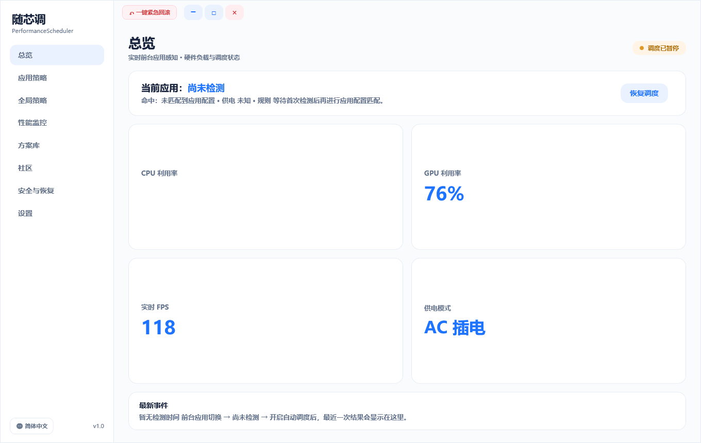
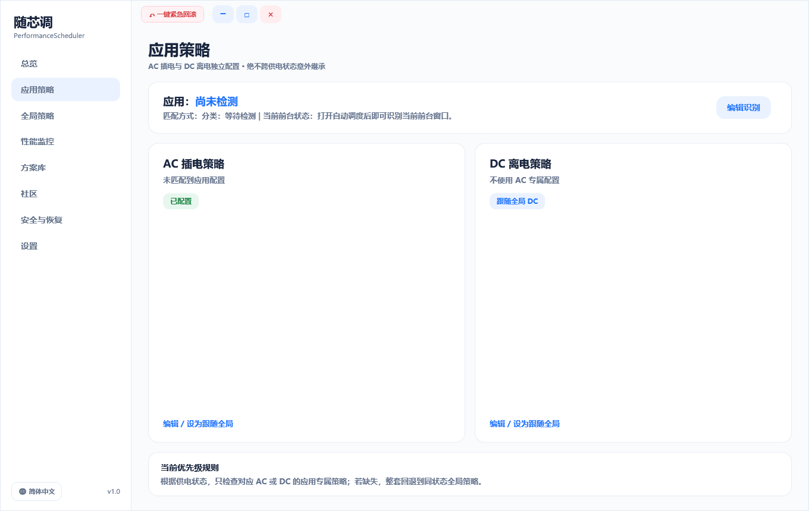
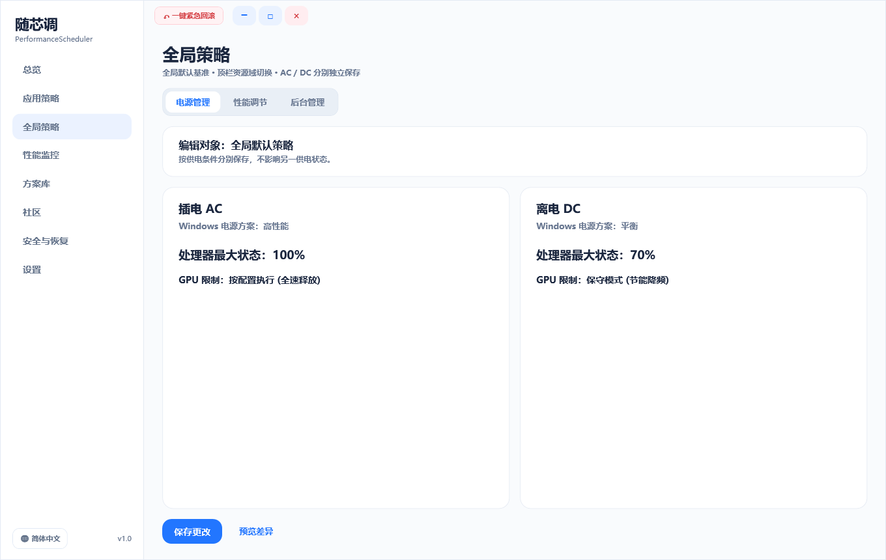
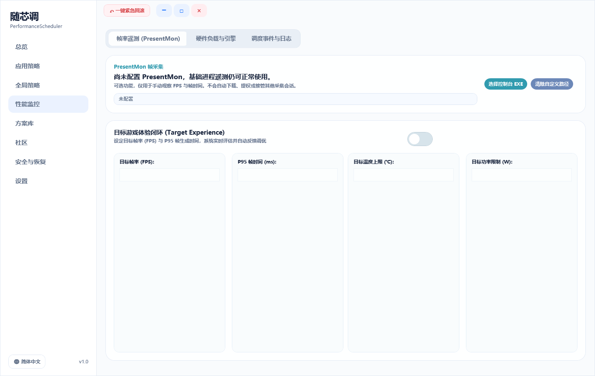
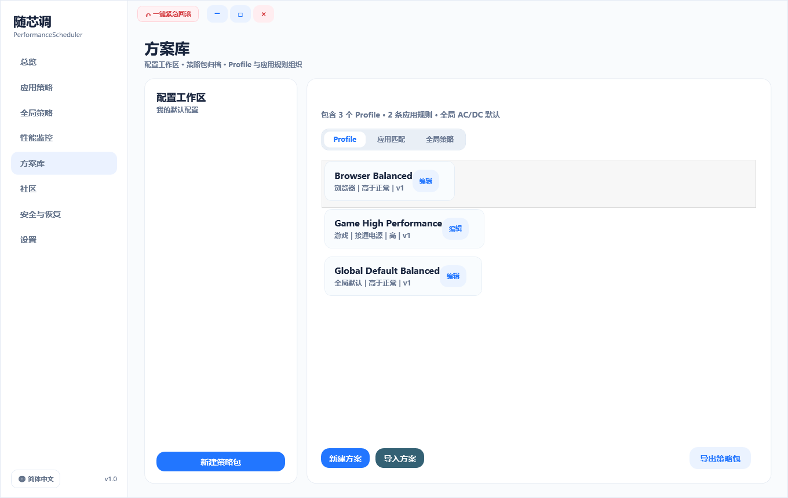
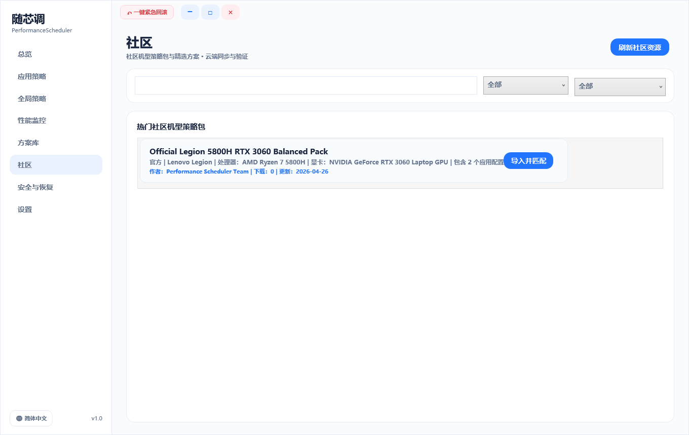
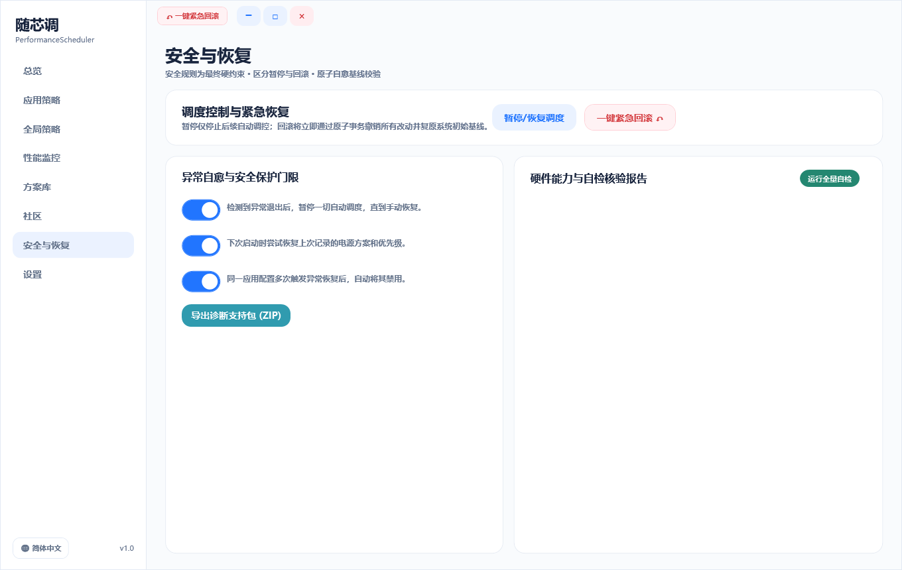
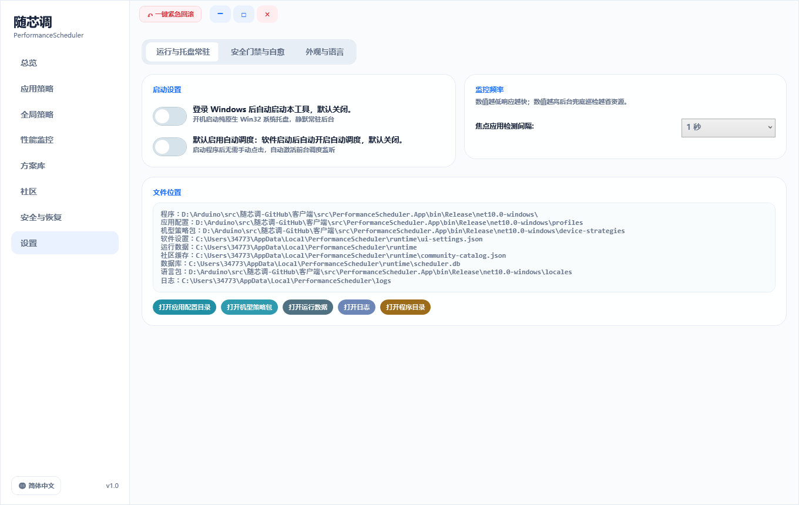

# 随芯调 (PerformanceScheduler) - UI / UX 视觉预览画廊

基于《随芯调 PerformanceScheduler 双层混合型 UI / UX 与策略体系设计文档》（设计草案 v1.0）构建的原生全景无滚轮（Zero Scrolling）界面实机高清渲染图。

---

## 页面预览导航

### 01. 总览 (Overview)
实时前台应用感知、命中策略与 2x2 核心硬件指标大卡片（CPU/GPU 利用率、实时 FPS、供电状态）及最新事件审计。

---

### 02. 应用策略 (App Profiles)
前台应用进程识别与 AC 插电 / DC 离电独立双轨策略入口，绝不跨供电状态意外继承。

---

### 03. 全局策略 (Global Policies)
顶部资源域胶囊切换（电源管理 / 性能调节 / 后台管理），AC / DC 双轨独立全局默认基准对比与编辑。

---

### 04. 性能监控 (Performance)
PresentMon 帧率抓取集成、目标体验闭环（FPS / P95 帧时间 / 温度 / 功耗）与 Windows 硬件计数器监控。

---

### 05. 方案库 (Strategy Library)
配置工作区、机型策略包归档组织与包含 Profile 方案列表。

---

### 06. 社区 (Community)
社区热门机型策略包与精选应用方案云端检索、筛选与本地设备指纹一键匹配。

---

### 07. 安全与恢复 (Safety & Recovery)
调度暂停 vs 原子一键紧急回滚区分，急停安全门控配置与全量自检报告。

---

### 08. 设置 (Settings)
开机自启、Win32 原生系统托盘常驻守护、前台扫描轮询频率与数据文件路径。

